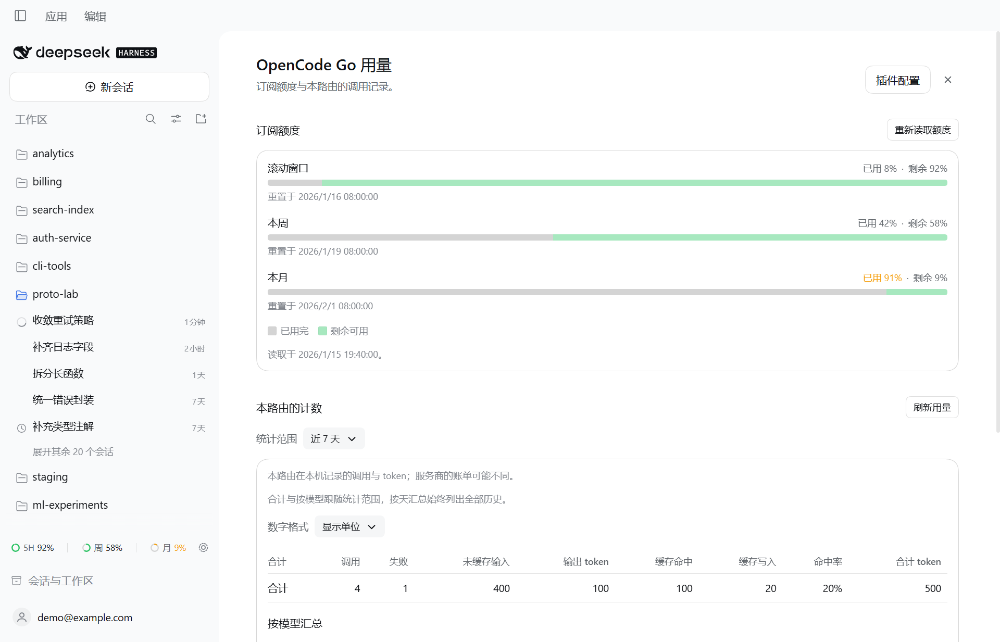
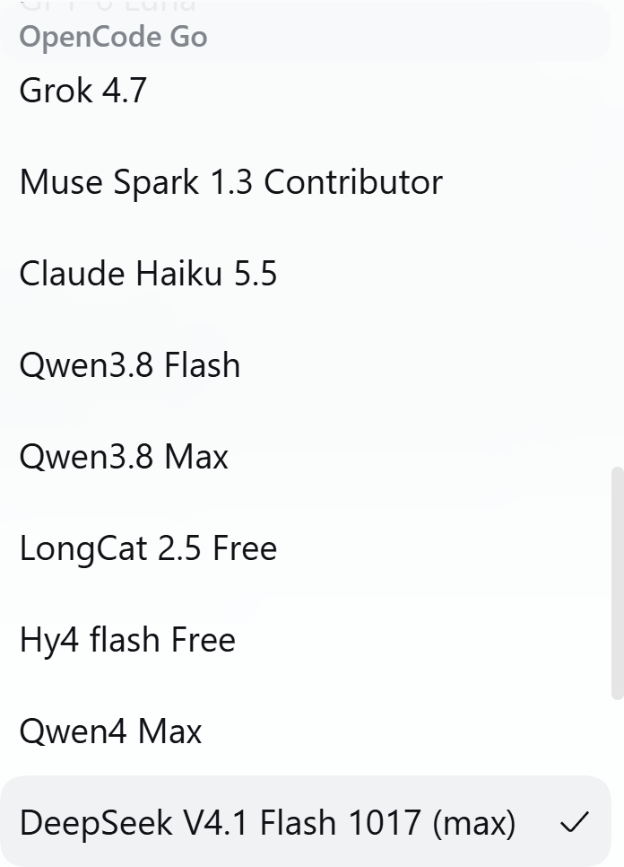
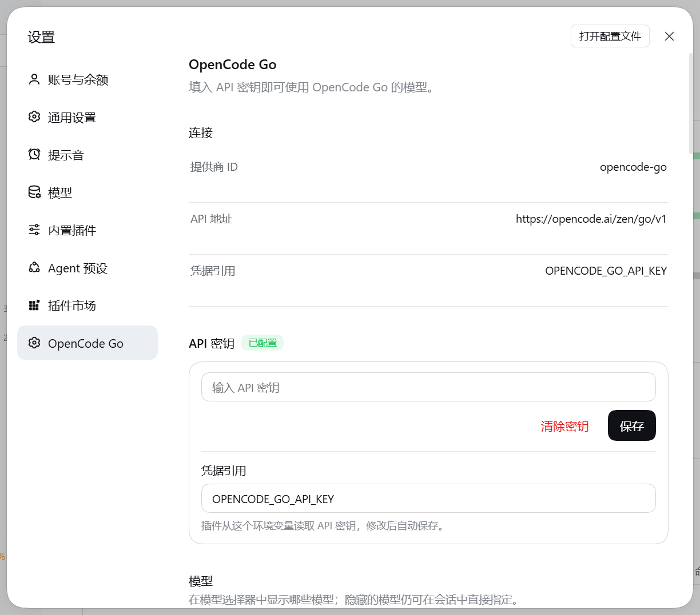
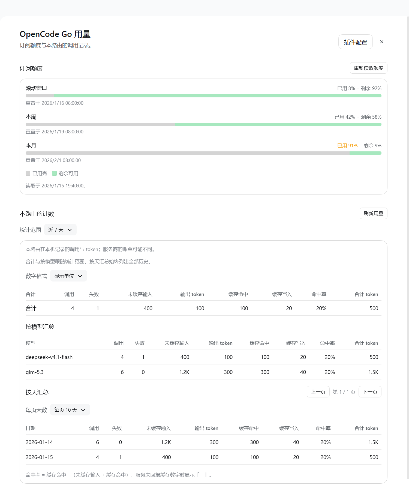

# dsh-llm-opencode-go

**English** | [简体中文](README.zh-CN.md)

[](https://www.npmjs.com/package/dsh-llm-opencode-go)
[](https://www.npmjs.com/package/dsh-llm-opencode-go)
[](docs/development.md#verification)
[](https://github.com/a2580vb/dsh-llm-opencode-go/actions/workflows/ci.yml)
[](LICENSE)

A DeepSeek Harness (DSH) plugin that serves **OpenCode Go** (`https://opencode.ai/inference/go/v1`) as a native model provider. The plugin implements the service's three wire protocols itself: requests translate harness messages, tools and reasoning into the protocol's shape, and responses stream back as DSH `StreamChunk` values. Node.js ≥ 20; no runtime dependencies.



*The usage panel and the quota capsule in the web client. The quota and the counters in the image are sample data.*

## At a glance

| | |
|---|---|
| **Provider route** | `opencode-go`, or the name `provider` sets |
| **Protocols** | OpenAI Responses, OpenAI-compatible Chat Completions, Anthropic Messages |
| **Model facts** | Live `GET /models` rows, with a dated `models.dev` snapshot as the fallback |
| **Runtime** | Node.js ≥ 20 |
| **Runtime dependencies** | None |

## Features

- **Model discovery.** `GET /models` supplies each model's display name, description, context window, output cap, input modalities, reasoning ladder and preferred protocol. The answer is cached in memory and on disk; a `models.dev` snapshot covers deployments that cannot reach the service.
- **Protocol selection per model.** The catalog carries an ordered protocol list per model, opening with the service's preferred `api` entry. A call the service refuses with `ModelProtocolUnsupported` is retried on the next protocol; any other failure is reported as it is.
- **Session affinity.** Every request carries `x-opencode-session`, one stable id per conversation, which keeps a conversation's turns on the same upstream backend and prompt cache.
- **Tool calls.** Definitions, fragmented arguments, tool results and the follow-up turn are translated per protocol. A call and its result are sent together or left out, because every protocol rejects one half alone.
- **Reasoning.** Per-model effort ladders come from the service and are translated per protocol, including Anthropic thinking budgets. Reasoning history is replayed only where the upstream requires it.
- **Streaming.** Byte-level SSE framing becomes `StreamChunk` values, with usage, finish reason, an idle watchdog and a retry when a stream is cut off before its terminal event.
- **Failures.** HTTP status and transport failures map to stable, provider-neutral codes (`AUTH`, `RATE_LIMIT`, `QUOTA`, `CONTEXT_WINDOW_EXCEEDED`, `MODEL_DEPRECATED`, `MODEL_UNAVAILABLE`, …).
- **Configuration page.** One page in the web client, registered both in Settings' own navigation and on the sidebar Plugins page's row. It edits the API key, the credential reference, model visibility (retired rows included), model variants, the quota-refresh intervals and the transport/retry settings; it can re-read `GET /models` and shows what this route spent.
- **Usage surfaces.** A quota capsule at the sidebar's foot, a usage panel opened from it or with `Ctrl/Cmd+U`, and a tab under Settings → Built-in plugins.

## Quick start

### 1. Install

```sh
dsh plugin add dsh-llm-opencode-go
```

Bundle layers are read at startup, so fully restart the profile after installing. The startup log should carry:

```
dsh-llm-opencode-go: provider "opencode-go" ready at https://opencode.ai/inference/go/v1 (split endpoints, credential OPENCODE_GO_API_KEY, models discover)
```

### 2. Provide a key

Either export `OPENCODE_GO_API_KEY` in the environment that launches DSH, or store the key through the credential seam — the web client's Models page writes it there. The config holds the reference (`apiKeyEnv`), never the value; the plugin resolves the reference on every request, so a stored key applies to the next call without a restart.

### 3. Pick a model

Open the model picker and choose a model under the **OpenCode Go** route. The first catalog read fetches `GET /models`; later reads are answered from memory or the cache file.



*The model picker under the OpenCode Go group.*

## Configuration

Every key is optional. The shortest useful block restates the defaults:

```yaml
- insert:
    - id: opencode-go
      name: dsh-llm-opencode-go
      config:
        apiKeyEnv: OPENCODE_GO_API_KEY
```

`apiKeyEnv` is a credential **reference**, not the key itself. To point it at another variable:

```yaml
config:
  apiKeyEnv: OC_KEY
```

The full field table, catalog shaping and image-input settings live in [Configuration](docs/configuration.md).

### Graphical configuration

The plugin's page is also reachable from the web client: a row of Settings' own navigation (**OpenCode Go**), and the sidebar's **Plugins** page, where the bundle's row has a **Configure** control. Both register the same component. The page writes ordinary config fields through the profile patch, and the API key through the credential store; the key value never enters `cordis.patch.yml`. A deployment without a web client has no page and behaves the same otherwise. See [Configuration](docs/configuration.md#graphical-configuration).



*The configuration page. The API key is reported as configured; its value is never displayed.*

## Usage

Three entries read the same facts:

| Entry | Where |
|---|---|
| **The quota capsule** | At the sidebar's foot, beside Settings: one ring per metered window (`5H / Wk / Mo`), with what is left of each. The row opens the usage panel; the gear beside it opens the configuration page. |
| **The usage panel** | From that row, or the keyboard (`Ctrl/Cmd+U`): the subscription's windows first, this route's counters by model and by day under them. |
| **A tab under Settings → Built-in plugins** | The same content as the panel, on the settings surface. |

The panel keeps two sources apart. The subscription bars come from `GET {baseURL}/usage` and describe the plan's metered windows. The counters below them are what this plugin recorded locally at `~/.dsh/cache/opencode-go-usage.json`, aggregated by local calendar day. They answer different questions and can disagree. The capsule can be switched off (`showQuotaCapsule`, on by default); the panel and the tab stay.



*The usage panel: subscription windows above, this route's counters below. Sample data.*

## Verification

```sh
npm test             # the offline suite; no credential, no quota spent
npm run test:cordis  # mount the plugin on the harness's own cordis
npm run test:live    # live suite; needs OC_KEY
npm run check:pack   # read back what `npm publish` would upload
```

`npm test` replays response bodies captured from the live service (`tests/golden/`), so a translator that drifts from what the service sends fails offline. The offline count is restated in both README badges and in both development pages — the four places the runner checks when the suite finishes. Details in [Development](docs/development.md#verification).

## FAQ

### Do configuration changes need a restart?

No. The adapter reads the resolved config on each request, so a saved field applies to the next call. Installing or upgrading the plugin is the exception: bundle layers are read at startup.

### Does it work without the web client?

Yes. The configuration page, the capsule and the panel are web-client surfaces; a headless deployment has none of them, and the provider route is unchanged.

### Where is the API key stored?

In the harness credential store, under the name `apiKeyEnv` points at. The config file holds only that name, and no page endpoint returns the value.

### A model I use is gone from the picker. Can I still call it?

Yes, if the service still serves it or the catalog still carries its row. Retired models stay in the catalog with their last measured protocol order and capacity; the picker leaves them out, but a session that still names one resolves it and sends the call, and the service answers `MODEL_DEPRECATED` or `MODEL_UNAVAILABLE`. Hiding a model (`hiddenModels`) has the same listing-only effect.

### Why does an image not reach the model?

A route declares `image` only when the model takes images and the deployment can resolve their bytes through the attachment seam. Without the seam, `sendImages: auto` reports text-only and the model's description names what was left out; `always` attempts the bytes anyway and fails on the missing seam.

## Documentation

- [Models](docs/models.md) — live model facts, protocol preference and fallbacks, the training-data gate, the capacity snapshot, text/image split
- [Configuration](docs/configuration.md) — full field table, shaping the catalog, image input, the graphical and fast entries
- [Wire protocol](docs/wire-protocol.md) — endpoints and auth, `x-opencode-session`, reasoning and tool-calling translations
- [Reliability](docs/reliability.md) — stable failure codes and limits
- [Development](docs/development.md) — project status, verification suites, re-measure probes, architecture

## License

MIT
