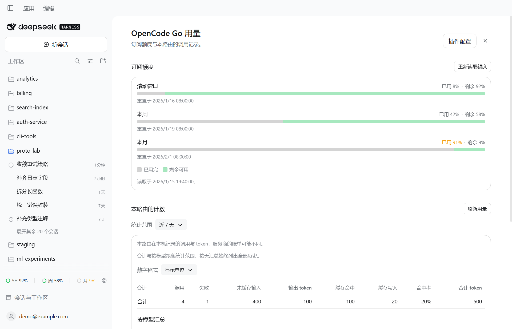
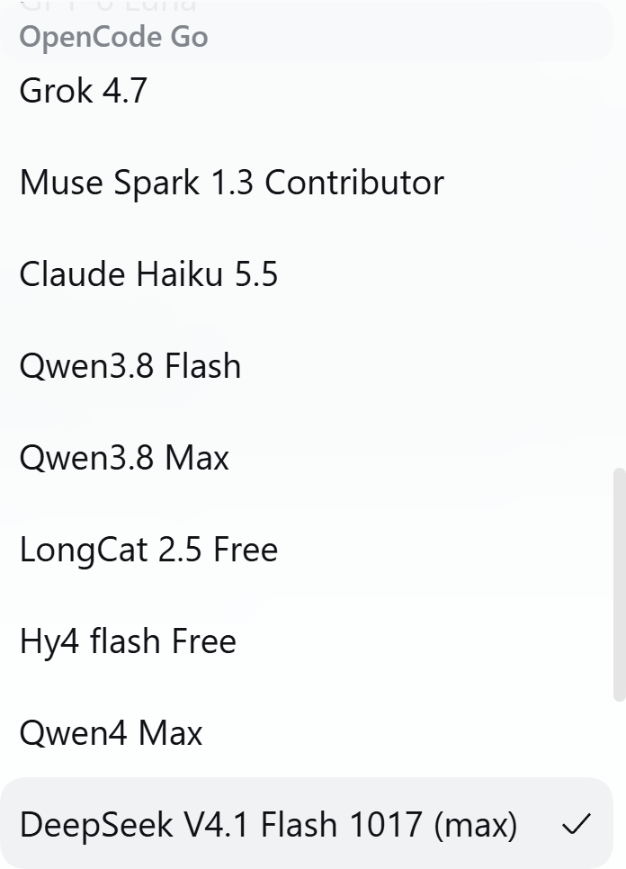
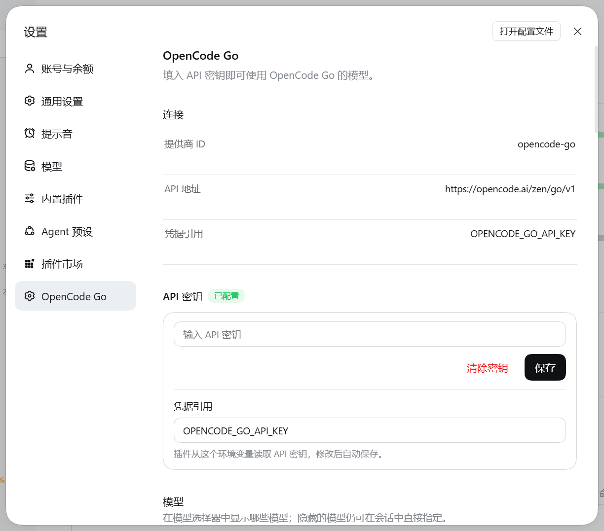
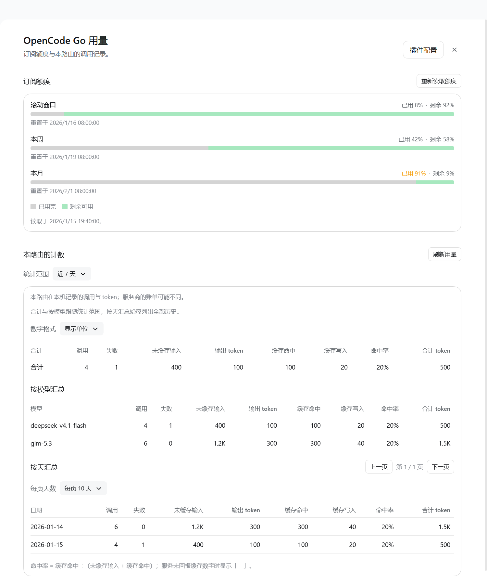

# dsh-llm-opencode-go

[English](README.md) | **简体中文**

[](https://www.npmjs.com/package/dsh-llm-opencode-go)
[](https://www.npmjs.com/package/dsh-llm-opencode-go)
[](docs/development.zh-CN.md#验证)
[](https://github.com/a2580vb/dsh-llm-opencode-go/actions/workflows/ci.yml)
[](LICENSE)

一个把 **OpenCode Go**（`https://opencode.ai/inference/go/v1`）作为 DSH 原生模型 provider 接入的 DeepSeek Harness（DSH）插件。插件自己实现该服务的三种线格式：请求把 Harness 的 messages、tools 与 reasoning 翻译成对应协议的形状，响应再以 DSH `StreamChunk` 流式返回。Node.js ≥ 20；无运行时依赖。



*Web 客户端里的用量面板与额度胶囊。图中的额度与计数是示例数据。*

## 一览

| | |
|---|---|
| **Provider 路由** | `opencode-go`，或 `provider` 指定的名字 |
| **协议** | OpenAI Responses、OpenAI 兼容 Chat Completions、Anthropic Messages |
| **模型事实** | 实时 `GET /models` 行；不可达时回落到带日期的 `models.dev` 快照 |
| **运行环境** | Node.js ≥ 20 |
| **运行时依赖** | 无 |

## 功能

- **模型发现。** `GET /models` 提供每个模型的显示名、描述、上下文窗口、输出上限、输入模态、思考阶梯与推荐协议。答案带内存缓存与磁盘缓存；服务不可达的部署由 `models.dev` 快照兜底。
- **逐模型选择协议。** 目录为每个模型保存一份有序协议列表，以服务在 `api` 里推荐的入口开场。被服务以 `ModelProtocolUnsupported` 拒绝的调用会走下一个协议；其它失败按原样上报。
- **会话亲和。** 每个请求携带 `x-opencode-session`——每段会话一个稳定 id——让一段对话的多个轮次落在同一个上游后端与同一份 prompt 缓存上。
- **工具调用。** 定义、分片的参数、工具结果与后续回合都按协议翻译。调用与它的结果要么一起发出，要么一起省略，因为三种协议都拒绝只发其中一半。
- **推理。** 逐模型的档位来自服务，按协议翻译，包含 Anthropic 的 thinking budget。只有上游要求时才回放历史 reasoning。
- **流式。** 字节级 SSE 分帧被翻成 `StreamChunk`，带 usage、结束原因和空闲看门狗；流在终止事件之前被切断时会重试。
- **失败。** HTTP 状态与传输失败映射为稳定的、与 provider 无关的错误码（`AUTH`、`RATE_LIMIT`、`QUOTA`、`CONTEXT_WINDOW_EXCEEDED`、`MODEL_DEPRECATED`、`MODEL_UNAVAILABLE` 等）。
- **配置页。** Web 客户端里的一页，同时注册在设置导航与侧边栏 Plugins 页的本插件行上。它编辑 API 密钥、凭据引用、模型可见性（含已失效行）、模型变体、额度刷新间隔与传输/重试设置；可以重新读取 `GET /models`，并显示这条路由花掉了多少。
- **用量入口。** 侧边栏底部的额度胶囊、从胶囊或 `Ctrl/Cmd+U` 打开的用量面板，以及设置 → 内置插件里的一个页签。

## 快速开始

### 1. 安装

```sh
dsh plugin add dsh-llm-opencode-go
```

bundle 层只在启动时读取，所以安装后需要**完全重启**该 profile。启动日志里应出现：

```
dsh-llm-opencode-go: provider "opencode-go" ready at https://opencode.ai/inference/go/v1 (split endpoints, credential OPENCODE_GO_API_KEY, models discover)
```

### 2. 提供密钥

在启动 DSH 的环境里导出 `OPENCODE_GO_API_KEY`，或走凭据接缝写入密钥——Web 客户端的「模型」页写的就是这里。配置里保存的是引用（`apiKeyEnv`），不是密钥值；插件每次请求都解析这个引用，因此写入的密钥对下一次调用即生效，无需重启。

### 3. 选择模型

打开模型选择器，选择 **OpenCode Go** 路由下的模型。第一次读取目录会请求 `GET /models`；之后的读取由内存或缓存文件回答。



*OpenCode Go 分组下的模型选择器。*

## 配置

所有键都是可选的。下面这段最短配置里的每个键都是默认值：

```yaml
- insert:
    - id: opencode-go
      name: dsh-llm-opencode-go
      config:
        apiKeyEnv: OPENCODE_GO_API_KEY
```

`apiKeyEnv` 是一个**凭据引用**，不是密钥本身。要换成另一个变量：

```yaml
config:
  apiKeyEnv: OC_KEY
```

完整字段表、目录塑造与图片输入设置见[配置](docs/configuration.zh-CN.md)。

### 图形化配置

插件页在 Web 客户端里有两个入口：设置导航里的一行（**OpenCode Go**），以及侧边栏 **Plugins** 页里本插件行上的**配置**（Configure）控件。两处注册的是同一个组件。页面通过 profile patch 写入普通配置字段，通过凭据存储写入 API 密钥；密钥值不会进入 `cordis.patch.yml`。没有 Web 客户端的部署没有这一页，其余行为不变。详见[配置](docs/configuration.zh-CN.md#图形化配置)。



*配置页。API 密钥显示为已配置，其值从不出现在页面上。*

## 用量

三个入口读的是同一份数据：

| 入口 | 位置 |
|---|---|
| **额度胶囊** | 侧边栏底部、Settings 旁边：每个计量窗口一枚环（`5H / 周 / 月`），各自显示剩余多少。点这一行打开用量面板，点旁边的齿轮打开配置页。 |
| **用量面板** | 从胶囊那一行，或快捷键（`Ctrl/Cmd+U`）打开：订阅的窗口在上，本路由按模型、按天的计数在下。 |
| **设置 → 内置插件里的页签** | 与用量面板相同的内容，在设置界面上。 |

面板把两个来源分开显示。订阅额度条来自 `GET {baseURL}/usage`，描述计划的计量窗口；下面的计数是本插件记录在 `~/.dsh/cache/opencode-go-usage.json` 的本地数据，按本机日历日聚合。两者回答不同的问题，可以不一致。胶囊可以关掉（`showQuotaCapsule`，默认打开）；面板与页签不受影响。



*用量面板：订阅窗口在上，本路由的计数在下。示例数据。*

## 验证

```sh
npm test             # 离线套件；不需要凭据，不花额度
npm run test:cordis  # 把插件挂到 Harness 自己的 cordis 上
npm run test:live    # 实测套件；需要 OC_KEY
npm run check:pack   # 读回 `npm publish` 会打包的内容
```

`npm test` 回放的是从线上服务抓取的响应体（`tests/golden/`），所以翻译器一旦偏离服务实际发送的内容，离线就会失败。离线检查数同时写在两份 README 徽章与两篇 development 页里——共四处，套件跑完会核对。细节见[开发](docs/development.zh-CN.md#验证)。

## 常见问题

### 改配置需要重启吗？

不需要。适配器在每次请求时读取解析后的配置，所以保存的字段对下一次调用生效。安装或升级插件是例外：bundle 层只在启动时读取。

### 没有 Web 客户端能用吗？

能。配置页、胶囊与面板都是 Web 客户端上的界面；headless 部署没有这些界面，provider 路由的行为不变。

### API 密钥存在哪里？

存在 Harness 的凭据存储里，名字由 `apiKeyEnv` 决定。配置文件里只有这个名字，页面的任何端点都不会返回值本身。

### 常用的模型从选择器里消失了，还能调用吗？

能——只要服务仍在提供它，或目录里还留着它的行。已失效模型会连同最后实测的协议顺序与容量留在目录里；选择器不列出它，但点名它的会话仍能解析并发出调用，由服务以 `MODEL_DEPRECATED` 或 `MODEL_UNAVAILABLE` 作答。用 `hiddenModels` 隐藏一个模型同样只影响列表。

### 图片为什么没有到达模型？

只有模型接受图片、并且部署能通过附件接缝解析出图片字节时，路由才会声明 `image`。没有附件接缝时，`sendImages: auto` 会把模型报告为纯文本，并在描述里说明漏掉了什么；`always` 会照常尝试发送字节，并在接缝缺失时失败。

## 文档

- [模型](docs/models.zh-CN.md)——服务公布的模型事实、协议偏好与回退、训练数据门控、容量快照、text/image 划分
- [配置](docs/configuration.zh-CN.md)——完整字段表、塑造目录、图片输入、图形化配置与快速入口
- [线协议](docs/wire-protocol.zh-CN.md)——endpoint 与鉴权、`x-opencode-session`、推理与工具调用翻译
- [可靠性](docs/reliability.zh-CN.md)——稳定错误码与限制
- [开发](docs/development.zh-CN.md)——项目状态、验证套件、重测探针、目录结构

## 许可证

MIT
